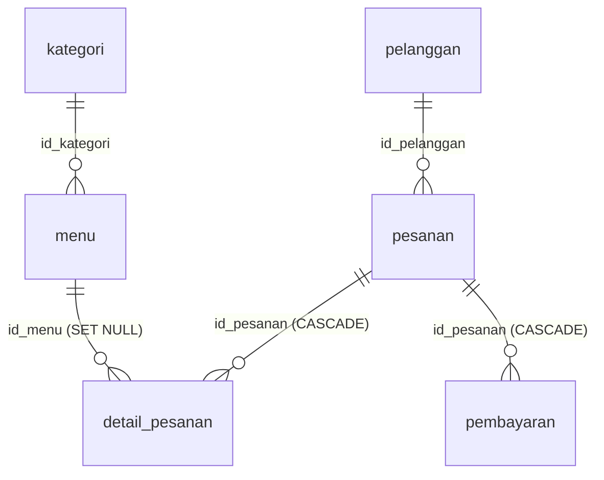

# Perancangan Sistem Informasi E-Commerce Model ERP Mampir Kopi

Sistem informasi e-commerce model ERP untuk kedai kopi **Mampir Kopi** (Kebon Jeruk, Jakarta Barat).
Pelanggan bisa melihat katalog, memesan, membayar (QRIS / e-wallet / COD), melacak pesanan,
dan mengelola wishlist — sementara admin mengelola stok, pengiriman, pengembalian & refund,
laporan keuangan, analitik, CRM, dan seluruh konten website dari satu panel.

- **Situs live:** http://mampirkopi.free.nf/
- **Teknologi:** PHP (tanpa framework) + MySQL/MariaDB + HTML/CSS/JavaScript vanilla
- **Database:** `db_kedai_kopi` — 19 tabel (lihat [Database](#database))

## Daftar Isi

- [Fitur](#fitur)
- [Cara Menjalankan di Localhost](#cara-menjalankan-di-localhost)
- [Akun Demo](#akun-demo)
- [Cara Deploy ke Hosting (InfinityFree)](#cara-deploy-ke-hosting-infinityfree)
- [Database](#database)
- [Alur Pemesanan & Pembayaran](#alur-pemesanan--pembayaran)
- [Struktur Folder](#struktur-folder)
- [API](#api)
- [Pengaturan Website (tabel `pengaturan`)](#pengaturan-website-tabel-pengaturan)
- [Keamanan](#keamanan)
- [Troubleshooting](#troubleshooting)

## Fitur

### Pelanggan
- Katalog 18 menu dalam 5 kategori (Signature, Non Coffee, Iced Coffee, Manual Brew, Hot),
  lengkap dengan varian ukuran (Small / Regular), gula, es, dan catatan.
- Keranjang, checkout **Ambil di Kasir** (gratis) atau **Diantar** (ongkir Rp5.000),
  kode promo, dan pembayaran QRIS / GoPay / OVO / DANA / ShopeePay / COD.
- Lacak pesanan dengan kode + email (tanpa perlu login), Riwayat pesanan, Pesan Lagi,
  Wishlist, Testimoni (dengan rating bintang), dan pengajuan Refund / Pengembalian.
- Edit Profil (nama, username, email, password, foto profil), lupa password,
  preferensi notifikasi, dan mode gelap (tema "Kedai Malam").

### Admin (Super Admin)
- Dashboard + CRM (data pelanggan, riwayat interaksi), Pesanan (detail, ubah status),
  Pembayaran (verifikasi / tolak), Stok, Pengiriman, Pengembalian & Refund.
- Laporan Keuangan (pemasukan, pengeluaran, export Excel `.xlsx`), Analitik
  (penjualan, kunjungan harian), Blog & Artikel, Testimoni, Pesan Masuk (kontak).
- Konten Website: edit hero, intro, Tentang, FAQ, Syarat & Ketentuan, Kebijakan Privasi,
  Galeri, dan 4 menu Andalan — tanpa menyentuh kode.
- Pengaturan Website: nama kedai, alamat, jam buka, telepon, Instagram, ongkir, logo.

## Cara Menjalankan di Localhost

Syarat: **XAMPP** (Apache + MySQL + PHP) atau server PHP + MySQL setara.

1. Salin folder `mampir-kopi` ke `C:\xampp\htdocs\` (atau folder web server Anda).
   Aktifkan **Apache** dan **MySQL** di XAMPP Control Panel.
2. Buka `http://localhost/phpmyadmin`, buat database bernama **`db_kedai_kopi`**,
   pilih database tersebut, lalu tab **Import** dan pilih file
   `database/db_kedai_kopi.sql`. File ini berisi struktur 19 tabel + data awal
   (menu, kategori, promo, FAQ, artikel, galeri, pengaturan, akun admin demo).
3. Jika user/password MySQL Anda bukan `root` / kosong, ubah di `api/config.php`:
   ```php
   const DB_HOST = '127.0.0.1';
   const DB_NAME = 'db_kedai_kopi';
   const DB_USER = 'root';
   const DB_PASS = '';           // XAMPP default: kosong
   ```
4. Buka `http://localhost/mampir-kopi/` untuk halaman tamu, atau
   `http://localhost/mampir-kopi/login.html` untuk masuk/daftar.
   Setelah login, pelanggan menuju `dashboard.html` dan admin menuju panel admin.

> **Penting:**
> - Buka lewat `http://localhost/...`, jangan klik dua kali file HTML — PHP tidak akan jalan.
> - File SQL hanya untuk **instalasi awal**. Jangan impor ulang ke database yang sudah
>   berisi data (pesanan, pelanggan, dsb.) — file ini berisi data contoh dan bukan
>   mekanisme sinkronisasi atau migrasi. Update aplikasi dilakukan dengan menimpa
>   folder saja, database tidak pernah diimpor ulang.

## Akun Demo

| Peran | Username | Password |
|---|---|---|
| Admin (Super Admin) | `admin` | `admin123` |

- Akun admin demo sudah ada di file SQL. Pelanggan daftar sendiri lewat `login.html`
  (file SQL tidak menyertakan akun pelanggan — data pelanggan asli tidak dipublikasikan).
- **Ganti password demo sebelum dipasang online.**

## Cara Deploy ke Hosting (InfinityFree)

Situs live berjalan di InfinityFree (`mampirkopi.free.nf`, database
`if0_43504695_mampirkopi` di `sql306.infinityfree.com`). Langkah deploy-nya:

1. **Upload file:** di File Manager hosting, upload ZIP berisi isi folder `mampir-kopi`
   ke `htdocs`, lalu **Extract**. Susunan file di root `htdocs` sama seperti di repo.
2. **Jangan upload folder `database/` ke `htdocs`.** File SQL hanya dipakai sekali
   lewat phpMyAdmin (langkah 3) — file `.sql` yang bisa diunduh publik adalah
   celah keamanan.
3. **Impor database:** di phpMyAdmin hosting, pilih database `if0_43504695_mampirkopi`,
   tab **Import**, pilih `database/db_kedai_kopi.sql`.
4. **Sesuaikan `api/config.php`** dengan kredensial database hosting
   (host, nama database, user, password dari panel hosting). Kredensial hosting
   **tidak boleh** masuk ke repo ini.
5. Buka domain hosting dan login sebagai admin untuk memastikan semuanya jalan.

> Catatan: salinan di hosting dan salinan localhost adalah **dua database terpisah**
> dan tidak tersinkronisasi. Pesanan yang masuk di situs live hanya ada di database live.

## Database

Satu database, **`db_kedai_kopi`** (nama di hosting: `if0_43504695_mampirkopi`),
mesin **InnoDB**, charset **utf8mb4**. Terdiri dari **19 tabel**, dikelompokkan
per modul berikut.

### Ringkasan 19 tabel

| # | Tabel | Isi | Data awal |
|---|---|---|---|
| 1 | `admin` | Akun admin (Super Admin) | 1 baris |
| 2 | `pelanggan` | Akun pelanggan + preferensi | kosong |
| 3 | `kategori` | Kategori menu | 5 baris |
| 4 | `menu` | Daftar menu + harga + stok | 18 baris |
| 5 | `pesanan` | Header pesanan | kosong |
| 6 | `detail_pesanan` | Item per pesanan (varian, harga saat pesan) | kosong |
| 7 | `pembayaran` | Pembayaran per pesanan + status verifikasi | kosong |
| 8 | `pengembalian` | Pengajuan pengembalian / refund | kosong |
| 9 | `pengeluaran` | Pengeluaran kedai (laporan keuangan) | kosong |
| 10 | `wishlist` | Menu favorit pelanggan | kosong |
| 11 | `testimoni` | Testimoni + rating pelanggan | kosong |
| 12 | `promo` | Kode promo / voucher | 3 baris |
| 13 | `artikel` | Artikel blog | 4 baris |
| 14 | `faq` | Pertanyaan yang sering diajukan | 7 baris |
| 15 | `galeri` | Foto galeri halaman tamu | 10 baris |
| 16 | `pesan_kontak` | Pesan dari formulir Kontak Kami | kosong |
| 17 | `pengaturan` | Semua pengaturan & teks konten website (key–value) | 38 kunci |
| 18 | `kunjungan` | Hitungan kunjungan harian (analitik) | kosong |
| 19 | `interaksi` | Catatan interaksi CRM per pelanggan | kosong |

### Skema per tabel

#### `admin` — akun admin
| Kolom | Tipe | Keterangan |
|---|---|---|
| `id_admin` | int, PK, AUTO_INCREMENT | |
| `nama` | varchar(80) | Nama tampilan |
| `username` | varchar(50), UNIQUE | Dipakai login |
| `email` | varchar(100), UNIQUE | |
| `password` | varchar(255) | Hash bcrypt |
| `role` | varchar(30), default `'Kasir'` | Akun demo: `Super Admin` |
| `status` | varchar(20), default `'Aktif'` | |
| `terakhir_login` | datetime, NULL | |
| `sesi_versi` | int, default 0 | Naik saat password berubah → sesi lama hangus |
| `foto`, `foto_mime`, `foto_diubah` | mediumblob, varchar(50), datetime | Foto profil tersimpan di DB |

#### `pelanggan` — akun pelanggan
| Kolom | Tipe | Keterangan |
|---|---|---|
| `id_pelanggan` | int, PK, AUTO_INCREMENT | |
| `nama_pelanggan` | varchar(100) | Nama tampilan |
| `username` | varchar(50), UNIQUE | Identitas login (huruf kecil) |
| `email` | varchar(100), UNIQUE, NULL | Login bisa pakai username atau email |
| `password` | varchar(255) | Hash bcrypt |
| `no_hp` | varchar(20), NULL | |
| `alamat` | text, NULL | |
| `status` | varchar(20), default `'Aktif'` | |
| `tanggal_daftar` | datetime, default now | |
| `terakhir_login` | datetime, NULL | |
| `foto`, `foto_mime`, `foto_diubah` | mediumblob, varchar(50), datetime | Foto profil tersimpan di DB |
| `pref_notifikasi` | tinyint, default 1 | |
| `sesi_versi` | int, default 0 | Naik saat password berubah → sesi lama hangus |
| `pref_tema` | varchar(10), default `'terang'` | `'terang'` / `'gelap'` (mode gelap) |

#### `kategori` — kategori menu
| Kolom | Tipe | Keterangan |
|---|---|---|
| `id_kategori` | int, PK, AUTO_INCREMENT | |
| `nama_kategori` | varchar(50) | Signature, Non Coffee, Iced Coffee, Manual Brew, Hot |
| `slug` | varchar(60), UNIQUE | |
| `ikon` | varchar(10), default `'☕'` | |
| `gambar` | varchar(255), NULL | Gambar kategori (opsional) |

#### `menu` — daftar menu
| Kolom | Tipe | Keterangan |
|---|---|---|
| `id_menu` | int, PK, AUTO_INCREMENT | |
| `id_kategori` | int, FK → `kategori.id_kategori` | |
| `nama_menu` | varchar(80) | |
| `slug` | varchar(100), UNIQUE | |
| `deskripsi` | text, NULL | |
| `harga` | int | Harga Small (Rupiah) |
| `harga_regular` | int, default 0 | Harga Regular; `0` = tidak ada pilihan ukuran |
| `tipe` | enum `'es'`, `'panas'`, `'makanan'`, default `'es'` | |
| `gambar` | varchar(255), NULL | Foto di `uploads/menu/` |
| `stok` | int, default 100 | |
| `aktif` | tinyint, default 1 | `0` = disembunyikan dari katalog |

#### `pesanan` — header pesanan
| Kolom | Tipe | Keterangan |
|---|---|---|
| `id_pesanan` | int, PK, AUTO_INCREMENT | |
| `kode_pesanan` | varchar(20), UNIQUE | Format `MK-0001`, dst. |
| `id_pelanggan` | int, FK → `pelanggan.id_pelanggan` | |
| `tanggal_pesanan` | datetime, default now | |
| `subtotal` | int, default 0 | |
| `diskon` | int, default 0 | Potongan promo |
| `total_harga` | int | Subtotal − diskon + ongkir |
| `kode_promo` | varchar(30), NULL | |
| `status` | enum `'Menunggu'`, `'Diproses'`, `'Selesai'`, `'Dibatalkan'`, default `'Menunggu'` | |
| `cara_ambil` | varchar(20), default `'Ambil di Kasir'` | Atau `'Diantar'` |
| `alamat_antar` | text, NULL | Wajib bila Diantar |
| `ongkir` | int, default 0 | Rp5.000 bila Diantar |
| `idempotency_key` | varchar(64), NULL | UNIQUE bersama `id_pelanggan` — cegah pesanan ganda |
| `pernah_selesai` | tinyint, default 0 | Penanda pesanan pernah mencapai Selesai |

#### `detail_pesanan` — item per pesanan
| Kolom | Tipe | Keterangan |
|---|---|---|
| `id_detail` | int, PK, AUTO_INCREMENT | |
| `id_pesanan` | int, FK → `pesanan.id_pesanan` (CASCADE) | |
| `id_menu` | int, NULL, FK → `menu.id_menu` (SET NULL) | |
| `nama_menu` | varchar(80) | Nama disalin saat pesan (tetap benar walau menu berubah) |
| `ukuran` | varchar(20), NULL | Small / Regular |
| `gula` | varchar(20), NULL | |
| `es` | varchar(20), NULL | |
| `catatan` | varchar(100), NULL | |
| `harga_satuan` | int | Harga saat pesan |
| `jumlah` | int | |
| `subtotal` | int | harga_satuan × jumlah |

#### `pembayaran` — pembayaran per pesanan
| Kolom | Tipe | Keterangan |
|---|---|---|
| `id_pembayaran` | int, PK, AUTO_INCREMENT | |
| `kode_transaksi` | varchar(20), UNIQUE | |
| `id_pesanan` | int, FK → `pesanan.id_pesanan` (CASCADE) | |
| `metode` | varchar(30) | QRIS, GoPay, OVO, DANA, ShopeePay, COD |
| `jumlah` | int | |
| `status` | enum `'Menunggu Verifikasi'`, `'Terverifikasi'`, `'Refund'`, `'Ditolak'`, `'Kadaluarsa'`, default `'Menunggu Verifikasi'` | |
| `tanggal` | datetime, default now | |
| `alasan` | text, NULL | Alasan penolakan |

#### `pengembalian` — pengajuan pengembalian / refund
| Kolom | Tipe | Keterangan |
|---|---|---|
| `id_pengembalian` | int, PK, AUTO_INCREMENT | |
| `id_pesanan` | int | Pesanan yang dikembalikan |
| `id_pelanggan` | int | Pengaju |
| `alasan` | text | |
| `status` | varchar(20), default `'Menunggu'` | Menunggu / Disetujui / Ditolak |
| `dibuat` | datetime, default now | |
| `jenis` | varchar(20), default `'Pengembalian'` | `'Pengembalian'` atau `'Refund'` |
| `metode_refund` | varchar(30), NULL | Rekening / e-wallet tujuan |
| `tujuan_refund` | varchar(100), NULL | Nomor rekening / nomor e-wallet |
| `jumlah_refund` | int, NULL | Selalu penuh, termasuk ongkir |

#### `pengeluaran` — pengeluaran kedai
| Kolom | Tipe | Keterangan |
|---|---|---|
| `id_pengeluaran` | int, PK, AUTO_INCREMENT | |
| `tanggal` | date | |
| `keterangan` | varchar(200) | |
| `jumlah` | int, default 0 | |

#### `wishlist` — menu favorit
| Kolom | Tipe | Keterangan |
|---|---|---|
| `id_wishlist` | int, PK, AUTO_INCREMENT | |
| `id_pelanggan` | int | UNIQUE bersama `id_menu` — satu menu sekali per pelanggan |
| `id_menu` | int | |
| `dibuat` | datetime, default now | |

#### `testimoni` — testimoni pelanggan
| Kolom | Tipe | Keterangan |
|---|---|---|
| `id_testimoni` | int, PK, AUTO_INCREMENT | |
| `nama` | varchar(100) | |
| `isi` | text | |
| `rating` | tinyint, default 5 | 1–5 bintang |
| `aktif` | tinyint, default 0 | `1` = tampil publik (admin bisa menyembunyikan) |
| `dibuat` | datetime, default now | |
| `id_pelanggan` | int, NULL | Terhubung ke akun bila testimoni dari pelanggan login |

#### `promo` — kode promo
| Kolom | Tipe | Keterangan |
|---|---|---|
| `id_promo` | int, PK, AUTO_INCREMENT | |
| `kode` | varchar(30), UNIQUE | Mis. `NGOPI10`, `MAMPIR20`, `HEMAT5` |
| `judul` | varchar(80) | |
| `deskripsi` | varchar(200), NULL | |
| `tipe` | enum `'persen'`, `'nominal'`, default `'persen'` | |
| `nilai` | int | Persen atau Rupiah |
| `min_transaksi` | int, default 0 | Minimum belanja |
| `berlaku_sampai` | date, NULL | |
| `aktif` | tinyint, default 1 | |

Kode promo bawaan: `NGOPI10` (diskon 10%, tanpa minimum), `MAMPIR20`
(potong Rp20.000, min. Rp100.000), `HEMAT5` (potong Rp5.000, min. Rp30.000).

#### `artikel` — artikel blog
| Kolom | Tipe | Keterangan |
|---|---|---|
| `id_artikel` | int, PK, AUTO_INCREMENT | |
| `judul` | varchar(200) | |
| `slug` | varchar(220), UNIQUE | |
| `ringkasan` | varchar(300), default `''` | |
| `isi` | text | |
| `gambar` | varchar(255), default `''` | |
| `dibuat` | datetime, default now | |

#### `faq` — pertanyaan umum
| Kolom | Tipe | Keterangan |
|---|---|---|
| `id_faq` | int, PK, AUTO_INCREMENT | |
| `pertanyaan` | varchar(200) | |
| `jawaban` | text | |
| `urutan` | int, default 0 | |
| `aktif` | tinyint, default 1 | |

#### `galeri` — foto galeri
| Kolom | Tipe | Keterangan |
|---|---|---|
| `id_galeri` | int, PK, AUTO_INCREMENT | |
| `gambar` | varchar(255) | Path foto |
| `judul` | varchar(100) | |
| `urutan` | int, default 0 | |
| `aktif` | tinyint, default 1 | |
| `lebar` | tinyint, default 0 | `1` = foto tampil lebar di grid |

#### `pesan_kontak` — pesan dari Kontak Kami
| Kolom | Tipe | Keterangan |
|---|---|---|
| `id_pesan` | int, PK, AUTO_INCREMENT | |
| `nama` | varchar(100) | |
| `email` | varchar(150) | |
| `pesan` | text | |
| `dibaca` | tinyint, default 0 | |
| `dibuat` | datetime, default now | |

#### `pengaturan` — pengaturan & teks konten (key–value)
| Kolom | Tipe | Keterangan |
|---|---|---|
| `kunci` | varchar(60), PK | Nama pengaturan, mis. `nama_kedai`, `ongkir` |
| `nilai` | text, NULL | Nilai / isi teks (bisa Markdown) |

38 kunci bawaan — lihat [Pengaturan Website](#pengaturan-website-tabel-pengaturan).

#### `kunjungan` — kunjungan harian
| Kolom | Tipe | Keterangan |
|---|---|---|
| `tanggal` | date, PK | |
| `jumlah` | int, default 0 | Jumlah kunjungan hari itu |

#### `interaksi` — catatan CRM
| Kolom | Tipe | Keterangan |
|---|---|---|
| `id_interaksi` | int, PK, AUTO_INCREMENT | |
| `id_pelanggan` | int | Pelanggan yang dicatat |
| `catatan` | text | |
| `dibuat` | datetime, default now | |

### Relasi antar tabel

Lima relasi ditegakkan sebagai `FOREIGN KEY` di database:



Relasi lain dijaga oleh aplikasi (tanpa FK di database):

| Dari | Ke | Lewat |
|---|---|---|
| `pengembalian` | `pesanan`, `pelanggan` | `id_pesanan`, `id_pelanggan` |
| `wishlist` | `pelanggan`, `menu` | `id_pelanggan`, `id_menu` |
| `testimoni` | `pelanggan` | `id_pelanggan` (opsional) |
| `interaksi` | `pelanggan` | `id_pelanggan` |

### Data awal (seed)

File `database/db_kedai_kopi.sql` berisi data awal berikut (total 86 baris):
admin 1, artikel 4, faq 7, galeri 10, kategori 5, menu 18, pengaturan 38 kunci,
promo 3. Tabel transaksional (`pelanggan`, `pesanan`, `detail_pesanan`,
`pembayaran`, `pengembalian`, `pengeluaran`, `wishlist`, `testimoni`,
`pesan_kontak`, `kunjungan`, `interaksi`) kosong — terisi saat website dipakai.

## Alur Pemesanan & Pembayaran

1. Pelanggan daftar / login, pilih menu (ukuran, gula, es, catatan) → keranjang.
2. Checkout: pilih **Ambil di Kasir** (gratis) atau **Diantar** (+Rp5.000, isi alamat),
   masukkan kode promo bila ada, pilih metode pembayaran, klik **Bayar Sekarang**.
3. Pesanan berstatus `Menunggu` dengan kode `MK-xxxx`. **Stok belum terpotong**
   pada tahap ini — stok baru terpotong saat pembayaran terverifikasi admin
   (transaksional, idempotent: verifikasi ganda tidak memotong dua kali).
4. **Batas bayar 5 menit** untuk QRIS / e-wallet: pesanan yang belum terverifikasi
   lewat dari 5 menit dibatalkan otomatis (sweeper). COD dikecualikan dari batas ini.
5. Admin memverifikasi pembayaran → status `Terverifikasi`, stok terpotong,
   pesanan bisa diproses → `Selesai`. Struk pembelian bisa dilihat pelanggan
   dari Riwayat (**Lihat Struk**).
6. Bila pesanan dibatalkan admin setelah dibayar: refund otomatis, stok kembali.
   Pelanggan juga bisa mengajukan **Refund / Pengembalian** dari detail pesanan
   di Riwayat (pesanan `Selesai`: Refund atau Kembalikan pesanan; pesanan berbayar
   `Menunggu`/`Diproses`: Refund saja). Bila admin menyetujui: pembayaran menjadi
   `Refund`, stok kembali, pesanan menjadi `Dibatalkan`. Refund selalu penuh,
   termasuk ongkir; transfer dilakukan manual oleh admin.

## Struktur Folder

```
mampir-kopi/
├── api/
│   ├── config.php     # Koneksi DB + fungsi bantu (ubah DB_* di sini)
│   ├── auth.php       # Login, daftar, logout, profil, reset password
│   ├── shop.php       # Menu, voucher, pesanan, riwayat (sisi pelanggan)
│   ├── admin.php      # Semua CRUD panel admin
│   └── export.php     # Export laporan ke Excel (.xlsx)
├── css/               # style.css, guest.css, dashboard.css, admin.css, tema-gelap.css, ...
├── js/                # shop.js, guest.js, admin.js, admin-fitur.js, konten.js, motion.js, ...
├── img/               # logo, foto menu, galeri, QRIS, logo e-wallet
├── uploads/menu/      # Foto menu yang diunggah admin
├── fonts/             # Font lokal (Fraunces, Plus Jakarta Sans, JetBrains Mono)
├── database/
│   └── db_kedai_kopi.sql   # Struktur 19 tabel + data awal (instalasi awal saja)
├── index.html         # Redirect ke tamu.html
├── tamu.html          # Beranda tamu (katalog publik)
├── login.html         # Masuk / daftar / lupa password
├── dashboard.html     # Beranda pelanggan setelah login
├── menu.html          # Katalog menu lengkap
├── keranjang.html     # Keranjang belanja
├── pembayaran.html    # Checkout + pembayaran
├── pesanan.html       # Buat / kelola pesanan
├── riwayat.html       # Riwayat pesanan + ajukan refund
├── lacak.html         # Lacak pesanan (kode + email, tanpa login)
├── wishlist.html      # Menu favorit
├── testimoni.html     # Testimoni pelanggan
├── blog.html          # Daftar artikel
├── artikel.html       # Isi artikel
├── promo.html         # Daftar promo / voucher
├── tentang.html       # Tentang kedai
├── kontak.html        # Kontak Kami (formulir → pesan_kontak)
├── faq.html           # Pertanyaan umum
├── syarat.html        # Syarat & Ketentuan
├── privasi.html       # Kebijakan Privasi
├── profil.html        # Edit Profil pelanggan
├── admin.html         # Panel admin (Super Admin)
├── 404.html           # Halaman tidak ditemukan
├── DESIGN.md          # Catatan desain
└── README.md          # Dokumen ini
```

## API

Semua endpoint mengembalikan JSON `{"ok": true, "data": ...}` atau
`{"ok": false, "error": "..."}`. Rute dipilih lewat parameter `r`,
mis. `api/shop.php?r=menu`. Endpoint yang mengubah data memakai pemeriksaan CSRF
(token dari `api/auth.php?r=csrf`).

| File | Rute | Keterangan |
|---|---|---|
| `api/auth.php` | `login`, `daftar`, `logout`, `me`, `csrf` | Autentikasi & sesi |
| | `profil`, `profil_update`, `profil_hapus_foto` | Profil pelanggan |
| | `foto`, `foto_publik` | Foto profil |
| | `reset` | Ganti password (verifikasi password lama) |
| `api/shop.php` | `menu`, `item`, `detail` | Katalog |
| | `banner`, `promo`, `info`, `konten` | Konten publik |
| | `order`, `riwayat` | Buat pesanan, riwayat |
| | `lacak` | Lacak pesanan (publik) |
| | `wishlist`, `wishlist_toggle` | Wishlist |
| | `testimoni`, `testimoni_kirim` | Testimoni |
| | `blog`, `artikel` | Artikel |
| | `kontak`, `kunjung`, `stats` | Formulir kontak, hitung kunjungan, statistik |
| | `pengembalian` | Ajukan pengembalian / refund |
| `api/admin.php` | `dashboard`, `analitik`, `keuangan`, `laporan`, `crm` | Dashboard & laporan |
| | `pesanan`, `pesanan_detail`, `pesanan_status`, `pesanan_delete` | Kelola pesanan |
| | `pembayaran`, `pembayaran_verify`, `pembayaran_tolak`, `pembayaran_delete` | Verifikasi bayar |
| | `pengiriman`, `stok`, `stok_save` | Pengiriman & stok |
| | `pengembalian_list`, `pengembalian_putus` | Putuskan pengembalian |
| | `menu`, `menu_save`, `menu_delete` | Kelola menu |
| | `kategori`, `kategori_save`, `kategori_delete` | Kelola kategori |
| | `promo`, `promo_save`, `promo_delete`, `promo_toggle` | Kelola promo |
| | `artikel_list`, `artikel_save`, `artikel_delete` | Kelola blog |
| | `faq_list`, `faq_save`, `faq_delete` | Kelola FAQ |
| | `galeri_list`, `galeri_save`, `galeri_delete` | Kelola galeri |
| | `testimoni_list`, `testimoni_save`, `testimoni_toggle`, `testimoni_delete` | Kelola testimoni |
| | `kontak_list`, `kontak_baca`, `kontak_delete` | Pesan masuk |
| | `pelanggan`, `pelanggan_detail`, `pelanggan_save`, `pelanggan_status`, `pelanggan_delete`, `pelanggan_reset_password` | Kelola pelanggan |
| | `pengeluaran_save`, `pengeluaran_delete` | Pengeluaran |
| | `interaksi_add` | Catatan CRM |
| | `konten_get`, `konten_save` | Konten website (CMS) |
| | `pengaturan_get`, `pengaturan_save` | Pengaturan website |
| | `logo_upload` | Ganti logo |
| | `admins`, `admin_save`, `admin_delete` | Kelola akun admin |
| | `profil_admin`, `profil_admin_update`, `profil_admin_hapus_foto` | Profil admin |
| `api/export.php` | — | Export laporan keuangan ke Excel (`.xlsx`) |

## Pengaturan Website (tabel `pengaturan`)

Semua teks dan pengaturan website tersimpan sebagai pasangan kunci–nilai dan bisa
diubah admin dari panel **Konten Website** / **Pengaturan Website** tanpa menyentuh kode.

| Kelompok | Kunci |
|---|---|
| Identitas toko | `nama_kedai`, `alamat`, `telepon`, `instagram`, `email`, `jam_buka`, `ongkir` |
| Hero tamu | `hero_tamu_kicker`, `hero_tamu_judul`, `hero_tamu_sub` |
| Hero dashboard | `hero_dash_kicker`, `hero_dash_judul`, `hero_dash_sub` |
| Login | `login_kicker`, `login_judul` |
| Intro | `intro_kicker`, `intro_judul`, `intro_teks` |
| Tentang | `tentang_judul`, `tentang_lead`, `tentang_cerita`, `tentang_visi`, `tentang_misi` |
| Andalan | `andalan_kicker`, `andalan_judul`, `andalan_ids` |
| Galeri | `galeri_kicker`, `galeri_judul`, `galeri_catatan` |
| FAQ | `faq_judul`, `faq_lead` |
| Syarat & Privasi | `syarat_judul`, `syarat_lead`, `syarat_isi`, `privasi_judul`, `privasi_lead`, `privasi_isi` |
| Sistem | `konten_seed_v1` |

Kontak toko saat ini: WhatsApp **+62 896-2264-2662**, Instagram **@mampir.kopi_**.
Alamat: Jl. Ff No. 24, RT.7/RW.5, Sukabumi Selatan, Kebon Jeruk, Jakarta Barat 11560.
Jam buka: setiap hari 08.00–22.00 WIB. Toko tidak punya email — halaman Kontak
hanya menampilkan WhatsApp dan Instagram.

## Keamanan

- Password disimpan sebagai **hash bcrypt** — tidak pernah teks biasa.
- Sesi login memakai `sesi_versi`: mengganti password menghanguskan semua sesi lama.
- Setiap pengiriman data yang mengubah state diperiksa **token CSRF**.
- Reset password (lupa password) memverifikasi **password lama**; identifier yang
  tidak dikenal mengembalikan pesan yang sama (anti-enumerasi), dibatasi 5x/jam/sesi.
- Foto profil disimpan sebagai BLOB di database (bukan file publik).
- Kredensial database hosting dan password admin **tidak boleh** masuk ke repo ini.
- Folder `database/` hanya untuk instalasi awal — jangan pernah di-upload ke folder
  web publik hosting.

## Troubleshooting

| Gejala | Penyebab & solusi |
|---|---|
| `Pastikan database sudah diimpor` di semua halaman | Database belum diimpor, atau `api/config.php` salah (host/user/password/nama DB). Impor `database/db_kedai_kopi.sql` dan periksa `DB_*`. |
| Halaman tampil tapi menu kosong / tombol tidak jalan | Dibuka sebagai file (`file://...`) — buka lewat `http://localhost/mampir-kopi/`. |
| Login gagal padahal username benar | Pastikan password benar; akun demo admin: `admin` / `admin123`. Bila lupa password admin, reset lewat phpMyAdmin (buat hash bcrypt baru) atau minta reset admin lain. |
| Pesanan hilang / batal sendiri | Pesanan QRIS/e-wallet yang belum terverifikasi batal otomatis setelah 5 menit. COD tidak kena batas ini. |
| Foto menu tidak muncul | Foto menu hasil upload admin tersimpan di `uploads/menu/` — pastikan folder ini ikut tersalin saat pindah server. |
| `Access denied for user 'root'@'localhost'` (MariaDB Linux) | Jalankan `ALTER USER 'root'@'localhost' IDENTIFIED VIA mysql_native_password USING PASSWORD('');` lewat socket MySQL. |
